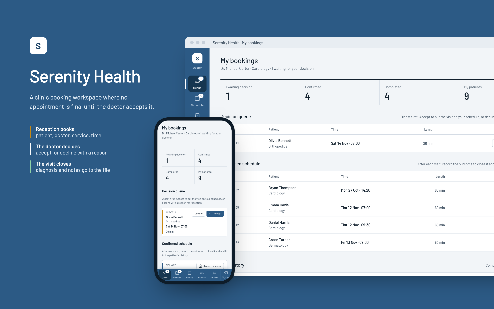
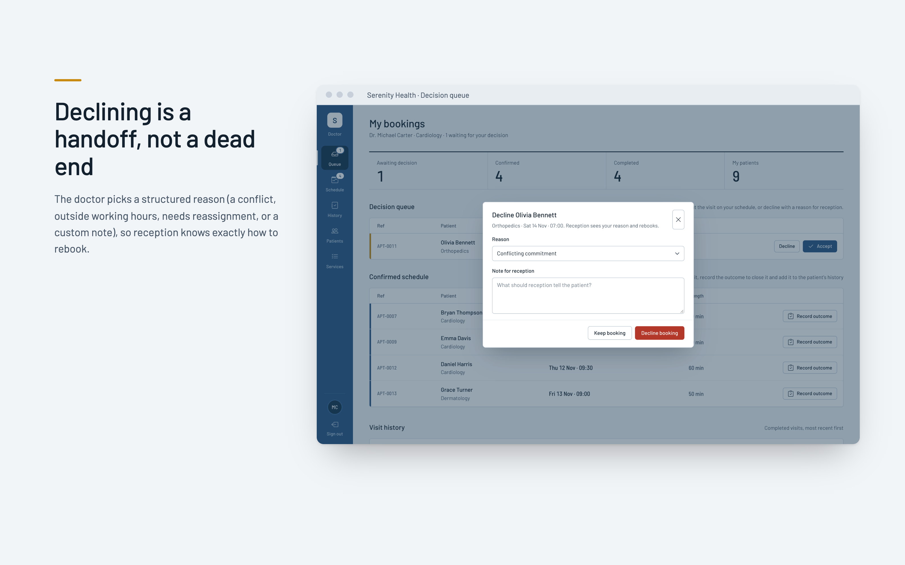
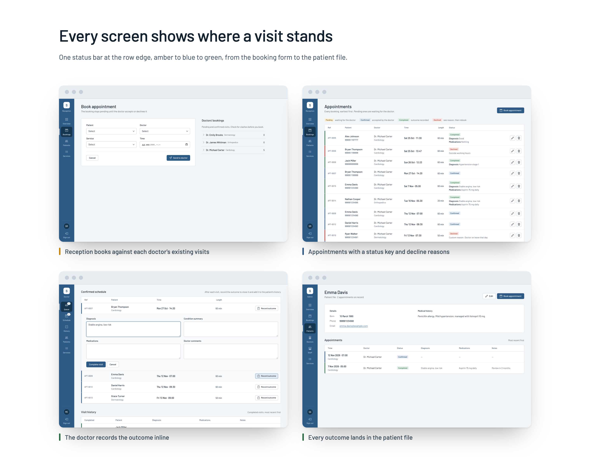
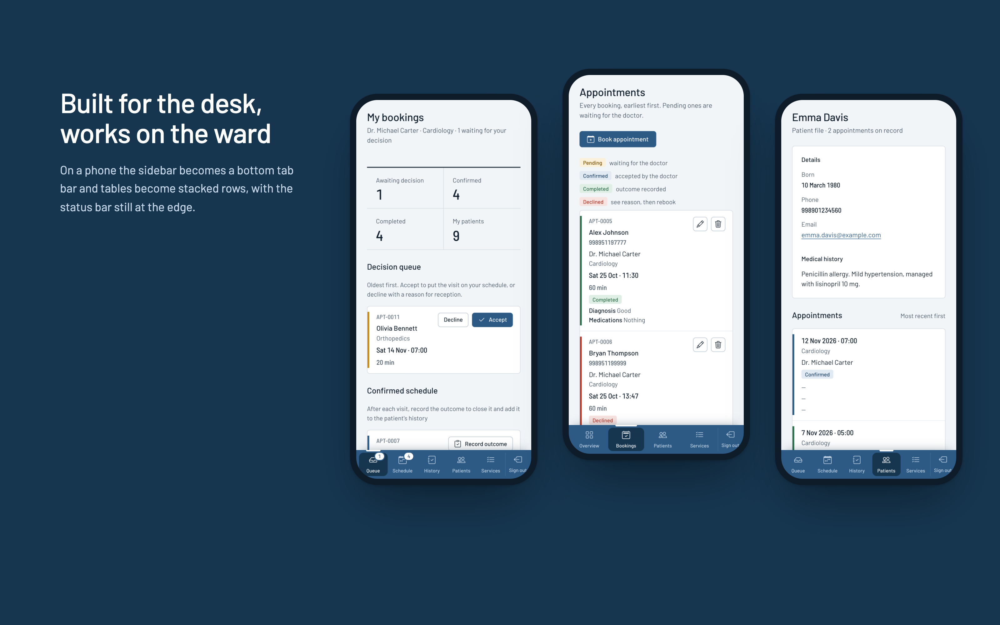
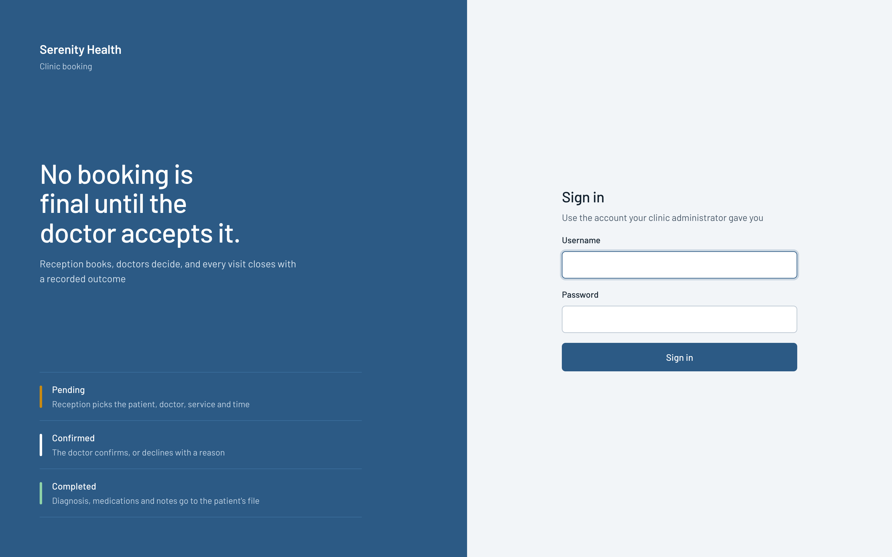
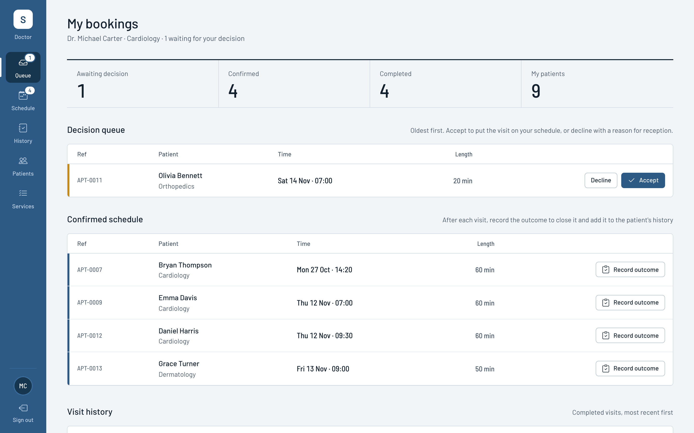
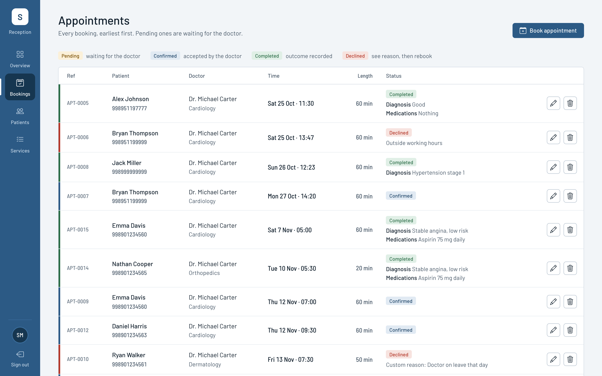
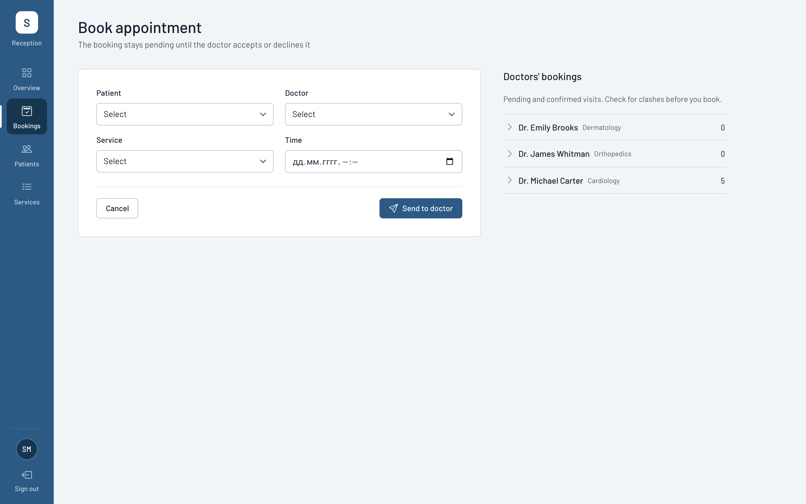
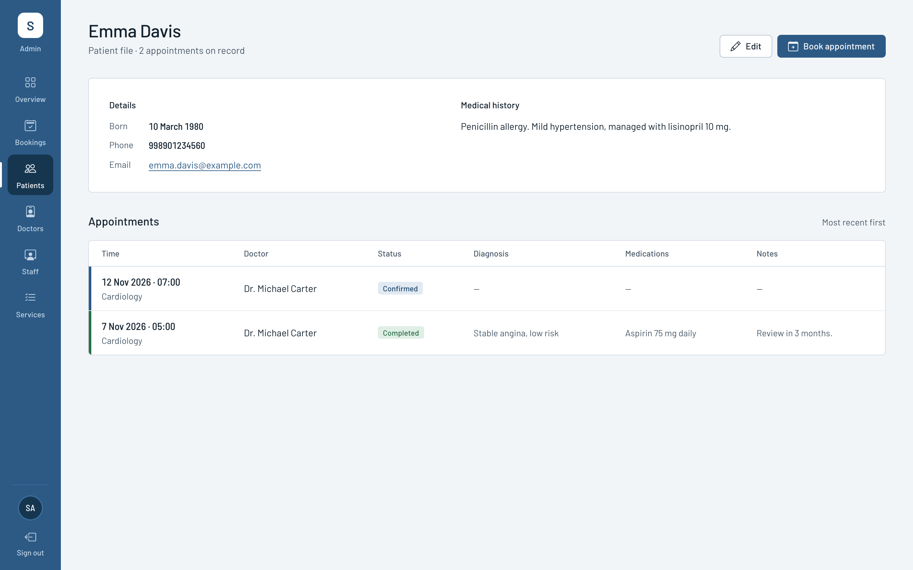
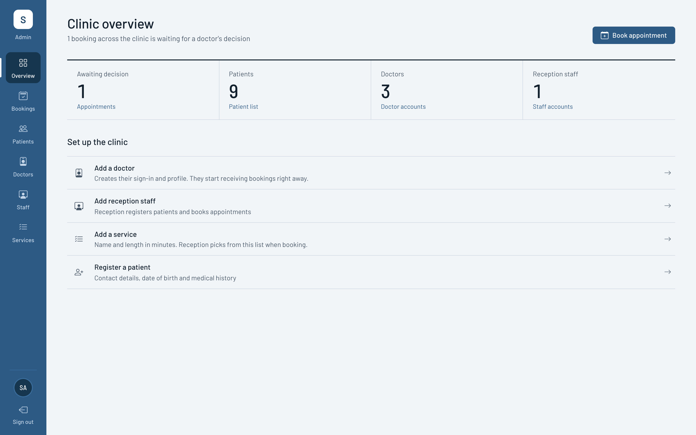

# Serenity Health

A clinic booking system for staff. Reception books patients with doctors, each doctor accepts or declines their own bookings, and every completed visit is closed with a recorded outcome that becomes part of the patient's history.



## Contents

- [How it works](#how-it-works)
- [Features by role](#features-by-role)
- [Screens](#screens)
- [Tech stack](#tech-stack)
- [Project structure](#project-structure)
- [Getting started](#getting-started)
- [Configuration](#configuration)
- [Development process](#development-process)
- [Design decisions](#design-decisions)
- [License](#license)

## How it works

No appointment is final until the assigned doctor accepts it. Every appointment moves through the same states, and every list in the app shows the state as a coloured bar on the left edge of the row.

| State | Colour | Meaning |
|---|---|---|
| Pending | Amber | Reception booked it; the doctor has not decided yet |
| Confirmed | Blue | The doctor accepted it; it is on their schedule |
| Completed | Green | The doctor recorded the diagnosis, condition summary, medications and comments |
| Declined | Red | The doctor declined it with a reason, so reception can rebook |

Decline reasons are structured: conflicting commitment, outside working hours, requires reassignment, or a custom note.

## Features by role

**Administrator**
- Clinic overview with pending bookings and staff counts
- Create, edit and delete doctors and reception staff, including their sign-in accounts
- Manage the service list (name and length in minutes)
- Everything reception can do

**Reception**
- Register, edit and delete patients (contact details, date of birth, medical history)
- Book appointments while seeing each doctor's pending and confirmed visits
- Follow every booking's status, including decline reasons and recorded outcomes

**Doctor**
- Decision queue of bookings waiting for them, oldest first
- Accept a booking, or decline it with a reason
- Confirmed schedule with an inline form to record the visit outcome
- Visit history and the list of their patients, with access to those patients' files

## Screens







| Sign in | Doctor: My bookings |
|---|---|
|  |  |
| **Appointments** | **Book appointment** |
|  |  |
| **Patient file** | **Clinic overview** |
|  |  |

All names and appointments in the screenshots are fictional demo data.

## Tech stack

| Layer | Technology |
|---|---|
| Backend | Python, Django 5.2 |
| Database | SQLite for local development, PostgreSQL in production (via `dj-database-url` and `psycopg` 3) |
| Frontend | Django templates, hand-written CSS (no CSS framework), vanilla JavaScript |
| Type and icons | Barlow and Barlow Semi Condensed (Google Fonts), Bootstrap Icons |
| Static files | WhiteNoise |
| Server and hosting | Gunicorn, Railway |

The JavaScript is progressive enhancement only. Every form works without it; the script adds the decline dialog (native `<dialog>`), the inline outcome form toggle, dismissible messages and the accept animation.

## Project structure

```
Hospital-Booking-System/
├── manage.py
├── requirements.txt
├── Procfile, railway.toml        # Railway deployment
├── DEPLOYMENT.md                 # Deployment guide
├── docs/                         # Mockups and screenshots used in this README
├── spass/                        # Django project: settings, root URLs, WSGI/ASGI
└── scheduling/                   # The application
    ├── models.py                 # Doctor, Receptionist, Patient, Service, Appointment
    ├── views.py                  # Role-based views and the booking workflow
    ├── forms.py                  # Model forms with shared styling
    ├── urls.py
    ├── context_processors.py     # Role flags for templates
    ├── signals.py                # Creates the Admin, Doctor and Receptionist groups
    ├── migrations/
    ├── templates/
    │   ├── base.html             # Shell: sidebar navigation and page header
    │   ├── partials/             # Form field, status pill and status bar snippets
    │   ├── registration/login.html
    │   └── ...                   # Dashboards, lists, forms and confirmations
    └── static/scheduling/
        ├── css/app.css
        └── js/app.js
```

## Getting started

Requires Python 3.10 or newer.

```bash
git clone https://github.com/samandar-ev/Hospital-Booking-System.git
cd Hospital-Booking-System

python -m venv .venv
source .venv/bin/activate          # Windows: .venv\Scripts\activate
pip install -r requirements.txt

python manage.py migrate           # also creates the Admin, Doctor and Receptionist groups
python manage.py createsuperuser
python manage.py runserver
```

Open http://127.0.0.1:8000 and sign in with the superuser. Superusers get the administrator workspace. From there:

1. Add at least one service under **Services**.
2. Add doctors under **Doctors** and reception staff under **Staff**. Each gets their own sign-in.
3. Register patients and book appointments. Patient phone numbers use the format `998XXXXXXXXX`.
4. Sign in as a doctor to accept, decline and complete bookings.

## Configuration

Settings are read from environment variables. See `.env.example`.

| Variable | Purpose | Default |
|---|---|---|
| `DJANGO_SECRET_KEY` | Secret key | Development key; always set in production |
| `DJANGO_DEBUG` | Debug mode | `True` |
| `DJANGO_ALLOWED_HOSTS` | Comma-separated hostnames | `127.0.0.1,localhost` |
| `DJANGO_CSRF_TRUSTED_ORIGINS` | Comma-separated origins | Railway and localhost |
| `DATABASE_URL` | Database connection string | Local SQLite file |

Deployment to Railway is described in [DEPLOYMENT.md](DEPLOYMENT.md).

## Development process

1. **Backend first.** Built the data model and the booking workflow in Django: role groups, per-doctor access checks, the pending → confirmed → completed flow, structured decline reasons and visit outcomes.
2. **Reviewing the first interface.** The original frontend was a Bootstrap dashboard with gradient tiles and hospitality wording ("guests", "concierge"). It did not show the most important fact about each booking: whether the doctor had accepted it.
3. **Defining the product.** Wrote down who uses each screen, what each role needs to do first, and the constraint that the redesign would change only templates, CSS and JavaScript, leaving views, models and forms untouched.
4. **Choosing a direction.** Sketched several visual directions as quick HTML prototypes and chose one built around a single status marker repeated on every list, with a restrained palette and one accent colour.
5. **Rebuilding every template.** Replaced Bootstrap with a small hand-written stylesheet, rewrote all 27 templates, replaced modal-heavy flows with an inline outcome form, and rewrote the copy in plain clinical language.
6. **Responsive and accessible.** Tested every page at desktop and phone widths. On phones the sidebar becomes a bottom tab bar and tables become stacked rows. Added visible focus states, labelled icon buttons, keyboard-friendly dialogs and reduced-motion support.
7. **Review and polish.** Ran structured design reviews against the original goals, then refined spacing to a 4px grid, simplified the status colours, and tested the accept, decline and complete flows end to end in a browser.

## Design decisions

- **Colour carries meaning.** Blue is the only action colour. Amber, blue, green and red are reserved for appointment status.
- **One position for status.** The status bar is always at the left edge of the row, so a whole list can be scanned in one glance.
- **Each role starts with its next action.** Doctors land on their decision queue, reception on booking, administrators on what is still pending.
- **Readable numbers.** Times, references, counts and durations use a condensed face with tabular figures, so columns line up.
- **Rows, not cards.** Lists are ruled tables, with durations right-aligned and actions pinned to the right.

## License

Released under the [MIT License](LICENSE).
